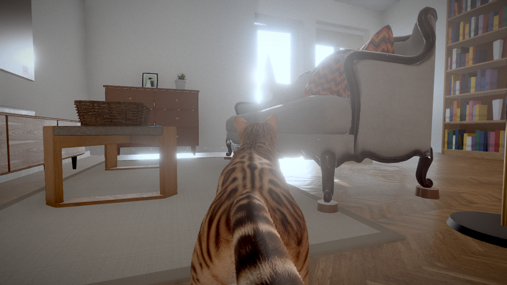
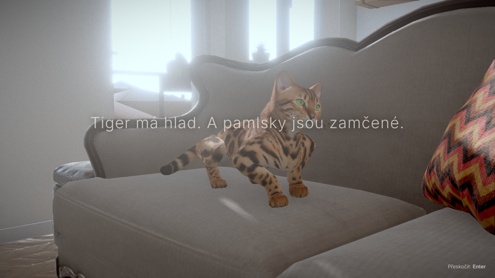
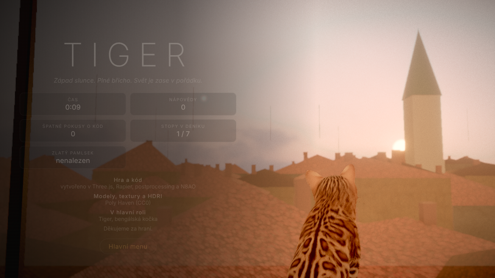

# Tiger – 3D úniková hra v prohlížeči

Hraješ za **Tigera**, bengálského kocoura. Páníčci odešli, automatické krmítko bliká červeně
a slunce se pomalu sklání nad střechy. Dostaň se k pamlskům v zamčené skříňce – a pak ven na
balkon, dřív než zapadne slunce.

Jedna vyladěná místnost (obývák s kuchyňským koutem, 6 × 5 × 2,7 m v reálném měřítku), osm kroků
hádanek, jedno tajemství, 20–30 minut hraní. Vše je česky.

- **Technologie:** Vite + TypeScript + Three.js (WebGL2), fyzika Rapier, post-processing
  `postprocessing` + `n8ao`.
- **Tiger:** model z `public/models/tiger.glb`, automaticky narigovaný (35 kostí), plně procedurální
  animace (chůze/klus/běh s IK tlapek, skok, plížení, švih tlapkou, čichání, olizování, ocas na
  pružinách, uši, pohled) a vrstvená srst (shell fur).
- **Světlo:** západ slunce postupuje s každou vyřešenou hádankou (4500 K → 2500 K → modrá hodinka),
  globální osvětlení ze světelných sond, měkké stíny, paprsky v prachu, AgX tone mapping.



| Úvod | Finále |
| --- | --- |
|  |  |

## Instalace a spuštění

Potřebuješ Node.js 20.19+ (nebo 22+) a prohlížeč s WebGL2 (Chrome, Edge, Firefox).

```bash
npm install
npm run dev        # vývojový server, adresu vypíše Vite (obvykle http://localhost:5173)
```

Produkční sestavení:

```bash
npm run build      # kontrola typů + sestavení do dist/
npm run preview    # náhled sestavené verze
```

Všechny modely, textury i HDRI jsou přímo v repozitáři (`public/`), hra při běhu nic nestahuje.
`node tools/fetch_assets.mjs` je umí stáhnout znovu z Poly Haven (viz [CREDITS.md](CREDITS.md)).

## Ovládání

| Akce | Klávesnice a myš | Gamepad (rozložení Xbox) |
| --- | --- | --- |
| Pohyb | `W` `A` `S` `D` / šipky | levá páčka |
| Rozhlížení | myš (po kliknutí do hry) | pravá páčka |
| Běh | `Shift` | `RB` / `RT` |
| Plížení (pod gauč) | `Ctrl` nebo `C` | `LT` |
| Skok | `Mezerník` – krátce: skok vpřed (sám doskočí na hranu před sebou) | `A` |
| Mířený skok | podrž `Mezerník`, zamiř kamerou, pusť – oblouk a značka ukážou dopad | podrž `A` |
| Tlapka (prozkoumat, shodit, hrabat, zapnout) | `E` nebo levé tlačítko myši | `X` |
| Strkání předmětů | `F` nebo pravé tlačítko myši | `B` |
| Kočičí smysly (pach, zvuk, noční vidění) | drž `Q` | `LB` |
| Nápověda (3 úrovně, další po 60 s) | `H` | `Y` |
| Deník stop | `Tab` | `Back` |
| Pauza / menu | `Esc` | `Start` |
| Kódový zámek | `A`/`D` výběr kolečka, `W`/`S` číslice, `E` / `Enter` potvrdit, `Esc` zpět | páčka, `X` potvrdit, `Start` zpět |

Skok: Tiger vyskočí těžištěm asi 0,9 m a tlapkami dosáhne zhruba do 1,5 m. Na linku se tedy musí
přes barovou židli, na parapet přes taburet. Zelený oblouk = doskočí, červený = nedoskočí.

## Nastavení kvality

V menu **Nastavení** (i během hry přes pauzu): předvolby **Nízká / Střední / Vysoká / Ultra**,
citlivost myši, obrácená osa Y, zorné pole, hlasitost hudby a zvuků, titulky, srst.
Předvolbu lze vynutit i adresou: `?quality=low|medium|high|ultra`.

| Předvolba | Stíny | GI (světelné sondy) | AO | Paprsky | Vrstvy srsti | Poznámka |
| --- | --- | --- | --- | --- | --- | --- |
| Nízká | 1024 | vypnuto (IBL) | – | – | 16 | integrované grafiky, 80 % rozlišení |
| Střední | 2048 | hrubá mřížka, 1 odraz | nízké | 12 kroků | 20 | |
| Vysoká | 4096 | plná mřížka, 2 odrazy | střední | 20 kroků | 24 | výchozí, cíl 60 FPS na RTX 3060 |
| Ultra | 4096 | plná mřížka, 3 odrazy | vysoké, plné rozlišení | 32 kroků | 32 | na HiDPI displejích až 1,5× rozlišení |

Další přepínače v adrese: `?fur=0` (bez srsti), `?gi=off|coarse|full`, `?rig=runtime` (vynutí rig
za běhu, varianta B), `?autostart=new|continue` (přeskočí menu).

## Řešení hádanek

<details>
<summary><b>Spoiler – kompletní návod</b> (klikni pro rozbalení)</summary>

1. **Čich.** Podrž `Q`. Vzduchem vedou tři pachové stopy: jantarová (pamlsky) vede do kuchyně
   k horní skříňce vedle lednice, růžová k lístečku na lednici a tyrkysová „tuňáková“ je
   falešná – končí u odpadkového koše s prázdnou konzervou. Dojdi po jantarové až pod skříňku.
2. **Lísteček na lednici.** Na skříňce je čtyřmístný zámek a na lednici pod magnetem lísteček.
   Vyskoč přes barovou židli na pult/linku, u lednice vyskoč a **ve vzduchu** u magnetu zmáčkni `E`.
   Lísteček sklouzne pod lednici – stoupni si před ni na zem a několikrát zmáčkni `E`, dokud ho
   nevyhrabeš. Text: *„Kód ke skříňce s pamlsky? Tigerovy narozeniny 😉 (DD MM)“*.
3. **Falešné stopy.** Prohlédni si (`E`) kalendář u kuchyně (zakroužkované 22. 7.), svatební fotku
   na komodě (9. 5. 2019) a lísteček na televizi (PIN 2580). Nic z toho není kód – Tiger to sám
   okomentuje. Stačí prozkoumat všechny tři.
4. **Průkaz pod gaučem.** Proplížit se (`Ctrl`) pod gauč a zapnout smysly (`Q`) – noční vidění
   ukáže očkovací průkaz u zadních nohou (blíž ke kuchyni). `E` ho přečte: datum narození
   **„1_. 0_.“** – druhé číslice jsou zalité kávou.
5. **Parkour k fotce.** Dostrkej taburet (`F`) pod okno. Potom taburet → parapet → závěsná police
   (houpe se a naklání, do 2 s z ní skoč dál) → vršek knihovny. Nahoře shoď zarámovanou fotku
   koťátka (`F`). Rám se dole rozbije; rub fotky (`E`) říká: *„Tiger, 4 týdny – 11. 4.“*
   Čtyři týdny (28 dní) před 11. dubnem je **14. března**.
6. **Zámek.** Vyskoč na linku pod skříňku, otevři zámek (`E`) a nastav **1 4 0 3**. Špatný kód =
   cvaknutí a švihnutí ocasem, tři špatné pokusy = 8 s uražené pauzy. Správný kód skříňku otevře,
   Tiger shodí sáček, pamlsky se rozsypou – sněz je (`E`).
7. **Vysavač.** Od balkonu to táhne (se smysly `Q` je slyšet pískání). Dveře jsou jen pootevřené.
   Odstrkej (`F`) botu a koš na prádlo z pruhu mezi dokovací stanicí vysavače (u východní stěny)
   a balkonovými dveřmi, pak vysavač zapni tlapkou (`E`). Dojede ke dveřím a dorazí je dokořán.
   Dá se na něm i svézt.
8. **Finále.** Vyjdi na balkon. Tiger se posadí proti západu slunce, běží titulky se statistikou.

**Tajemství – zlatý pamlsek („Král výšek“).** Z vršku knihovny je se smysly (`Q`) vidět zlatá
stopa přes závěsné svítidlo nad pultem. Mířeným skokem doskoč z knihovny na svítidlo – rozhoupe
se – a ve chvíli, kdy se kývne ke skříňkám, skoč na vršek horních kuchyňských skříněk. Tam leží
zlatý pamlsek. Ve finále pak Tiger neleží… vlastně leží: jako socha lva.

</details>

## Jak vyměnit model Tigera

1. Nahraď `public/models/tiger.glb` vlastním modelem čtyřnohé kočky (jedna síť s texturou,
   libovolná orientace a měřítko – normalizace je automatická: čumák do +Z, tlapky na Y = 0,
   kohoutek ~0,28 m).
2. **Varianta A (doporučená, kvalitnější váhy):** vygeneruj rig v Blenderu
   ```bash
   blender --background --python tools/rig_tiger.py -- public/models/tiger.glb public/models/tiger_rigged.glb
   # nebo bez Blenderu, s modulem bpy:  pip install bpy && python tools/rig_tiger.py public/models/tiger.glb public/models/tiger_rigged.glb
   ```
   Skript síť vyčistí, najde tlapky, páteř, hlavu, uši a ocas, postaví kostru, spočítá automatické
   váhy a uloží GLB s metadaty, která hra čte.
3. **Varianta B (funguje vždy):** smaž `public/models/tiger_rigged.glb`. Hra pak model analyzuje
   a naváže na kostru sama při načítání (`src/cat/RuntimeRig.ts`). Vyzkoušet jde i bez mazání
   přes `?rig=runtime`.

Barvu očí, délku srsti a třpyt upravíš v `src/cat/Fur.ts`.

## Jak vyměnit zvuky

Všechny zvuky i hudba se syntetizují procedurálně (Web Audio). Vlastní nahrávku stačí vložit do
`public/audio/` jako `<název>.ogg` (nebo `.mp3` / `.wav`) – použije se místo syntézy. Seznam
názvů (`meow`, `purr`, `step`, `glass`, `vacuum`, …) je v [public/audio/README.md](public/audio/README.md).
Po přidání souboru obnov stránku (dev) nebo znovu sestav (`npm run build`).

## Testy a nástroje

```bash
npm run build
npm run test:playthrough   # automatický průchod celou hrou (Playwright, headless Chromium)
npm run test:shots         # klíčové záběry do screenshots/
npm run test:fps           # měření výkonu na předvolbě Vysoká
```

- `tools/playthrough.mjs` projde všech osm kroků i tajemství skutečnými vstupy (chůze, skoky,
  tlapka, zámek), ověří nápovědy, autosave, finále a to, že v konzoli není žádná chyba.
- Testy běží bez grafické karty na softwarovém rasterizéru (SwiftShader). Na stroji s GPU přidej
  `TIGER_GPU=1` (a případně `TIGER_HEADED=1`).

### Debug API

V konzoli prohlížeče je k dispozici `window.__tigerDebug`:

| Volání | Co dělá |
| --- | --- |
| `state()` | stav hry, poloha Tigera, vyřešené kroky, FPS, draw calls |
| `steps()`, `gotoStep(id)`, `solveStep(id)` | přehled kroků, skok na krok, okamžité vyřešení (`scent`, `note`, `falseClues`, `card`, `photo`, `lock`, `vacuum`, `finale`, `golden`) |
| `teleport(x, y, z, yaw)`, `jumpTo(x, y, z)`, `canReach(x, y, z)` | přesun, skok, test dosažitelnosti |
| `setSunPhase(0–8)` | fáze západu slunce |
| `showCollisions(true)`, `showFps(true)` | zobrazení kolizí, počitadlo FPS |
| `lock.set([1,4,0,3])`, `lock.confirm()`, `vacuum()` | kódový zámek, stav vysavače |
| `shot(px,py,pz, tx,ty,tz, fov)`, `clearShot()` | volná kamera pro screenshoty |
| `setManual(true)`, `simulate(s)`, `renderFrame(dt)` | deterministické krokování pro testy |

## Výkon

Cíl zadání je 60 FPS na RTX 3060 na předvolbě **Vysoká**. **Na skutečné grafické kartě se to
v prostředí, kde hra vznikala, změřit nedalo** – není v něm GPU a Chromium tam kreslí softwarovým
rasterizérem (SwiftShader). Změřit se dalo jen toto:

| Záběr (Vysoká, 1920 × 1080) | Draw calls | Trojúhelníky | Čas snímku na SwiftShaderu (4 jádra CPU) |
| --- | --- | --- | --- |
| obývák od křesla k oknu | 282 | 1,27 M | 10,0 s |
| okno a paprsky | 267 | 1,57 M | 9,3 s |
| kuchyň | 266 | 1,55 M | 6,5 s |
| celý pokoj od lednice | 311 | 1,70 M | 10,4 s |
| kamera přitlačená zdí k Tigerovi | 309 | 0,79 M | 9,5 s |

Softwarové časy o výkonu na GPU nic neříkají; směrodatný je rozpočet: do ~310 draw calls
a ~1,7 M trojúhelníků na snímek (včetně stínových průchodů a 24 vrstev srsti), AO a paprsky
v polovičním rozlišení, jedna stínová mapa 4096² + stín stojací lampy. To je zátěž, kterou by
karta třídy RTX 3060 měla v 1080p zvládat s rezervou – ale je to odhad, ne měření.

Změř si to sám:

```bash
npm run build
TIGER_GPU=1 TIGER_HEADED=1 npm run test:fps   # Vysoká, 1920×1080; vypíše WebGL renderer, FPS a „CÍL 60 FPS: SPLNĚN/NESPLNĚN“
```

nebo ve hře z konzole: `__tigerDebug.showFps(true)`. Kdyby to nestačilo, pomůže předvolba Střední,
případně `?fur=0`.

Provedené optimalizace: slučování statické geometrie podle materiálu (cca 600 → 250 draw calls),
instancing (knihy, město, vrstvy srsti, prach), poloviční rozlišení AO a paprsků, stíny slunce
jednou za snímek, stín stojací lampy jen každý 4. snímek, globální osvětlení se přepočítává jen při
změně fáze západu a po částech, LOD srsti při kameře přitlačené ke kočce.

## Známá omezení

- **FPS na GPU není změřeno** (viz výše).
- **Zvuk nikdo neposlouchal.** Testy ověřují jen to, že se zvuky ve správných chvílích spouštějí
  (počitadla `__tigerDebug.audioCounts()`); jak procedurální mňoukání, předení a hudba znějí,
  je potřeba posoudit ušima. Jakýkoli zvuk jde nahradit nahrávkou (viz výše).
- Obraz byl laděn podle screenshotů převážně z předvoleb Nízká a Střední na softwarovém rasterizéru;
  Vysoká a Ultra používají stejný kód s jemnější mřížkou GI, ostřejšími stíny a víc vrstvami srsti,
  ale v pohybu na skutečné grafické kartě vyzkoušené nebyly.
- Hra cílí na desktop (klávesnice + myš nebo gamepad); dotykové ovládání nemá.
- První načtení trvá několik sekund – zapéká se globální osvětlení.

## Struktura projektu

```
src/
  core/     smyčka, renderer a post-processing, vstupy, fyzika, zvuk, ukládání, herní tok
  world/    místnost, kuchyň, nábytek, rekvizity, materiály, osvětlení, obloha a město
  cat/      model, rig (runtime varianta B), animátor, srst, ovládání, kamera, smysly
  puzzles/  graf hádanek, interakce, deník; rooms/ = definice místností, steps/ = jednotlivé kroky
  ui/       HUD, menu, nastavení, deník, titulky
  debug/    window.__tigerDebug
tools/      rig_tiger.py (varianta A), fetch_assets.mjs, playthrough, screenshoty, FPS
public/     models/, assets/ (Poly Haven), audio/ (sloty pro vlastní zvuky)
```

Hádanky jsou datově řízený graf (`src/puzzles/PuzzleGraph.ts`): každý krok je samostatný modul
se závislostmi, nápovědami a obnovou stavu ze savu. Další místnost znamená přidat soubor do
`src/puzzles/rooms/` se seznamem kroků a postavit její svět ve `src/world/`.

Další dokumenty: [PLAN.md](PLAN.md) (milníky a ověřování), [DECISIONS.md](DECISIONS.md)
(rozhodnutí nad rámec zadání), [CREDITS.md](CREDITS.md) (assety a licence).
